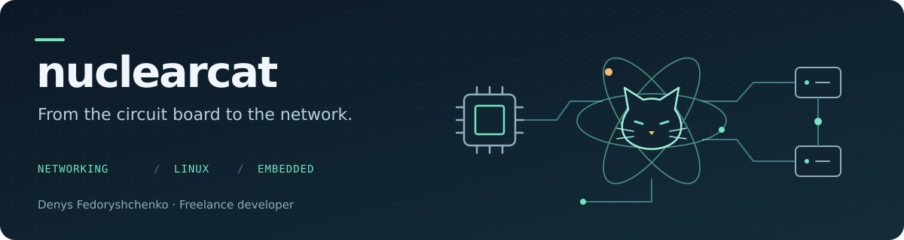

# Denys Fedoryshchenko

**Freelance developer · Networking · Linux · Embedded systems**

I build network services, Linux tools, and embedded devices—from ISP traffic management and routing software to ESP32 firmware and custom electronics. My work spans the circuit board, the firmware, the backend, and the interface used to manage it.

I also work at [Collabora](https://www.collabora.com/) on [KernelCI](https://github.com/kernelci), helping build and maintain infrastructure for testing the Linux kernel.

[Discuss a project](mailto:ncgh@nuclearcat.com) · [Website](https://nuclearcat.com) · [Telegram](https://t.me/nuclearcatlb)

## What I can help with

| Area | Work I do |
| :--- | :--- |
| **Networking & ISP tooling** | Routing, traffic shaping, RADIUS, NAT and flow telemetry, network diagnostics, and management interfaces. |
| **Linux & systems development** | Rust and C/C++ services, hardware diagnostics, monitoring, automation, and troubleshooting. |
| **Embedded & electronics** | ESP32 / ESP-IDF firmware, device integrations, custom PCBs, and tools for working with radio protocols. |
| **Backend & infrastructure** | APIs, dashboards, storage services, CI infrastructure, and integrations between devices and cloud services. |

## Selected public projects

| Project | What it does |
| :--- | :--- |
| **[nanoRadius](https://github.com/nuclearcat/nanoRadius)** | A lightweight RADIUS authentication and accounting server written in Rust. |
| **[accel-web](https://github.com/nuclearcat/accel-web)** | A web interface for administering accel-ppp, bringing network operations into the browser. |
| **[rs-linux-exporter](https://github.com/nuclearcat/rs-linux-exporter)** | A Prometheus-compatible Rust exporter for Linux system and hardware metrics. |
| **[ESP32ETH](https://github.com/nuclearcat/ESP32ETH)** | A compact ESP32 board with native Ethernet through the LAN8720 PHY, compatible with Arduino. |
| **[CedarKey](https://github.com/nuclearcat/cedarkey)** | Hardware SSH key storage using an inexpensive STM32 board and a small firmware footprint. |
| **[kernelci-status](https://github.com/nuclearcat/kernelci-status)** | A Rust status page and monitoring service with health checks, incident tracking, and notifications. |

[Explore more repositories →](https://github.com/nuclearcat?tab=repositories)

## Open-source contributions

Alongside my own projects, I contribute fixes and features upstream. A few examples:

- **RustyBGP:** [extended next-hop support on IPv4 sessions](https://github.com/osrg/rustybgp/pull/632) and [a fix for false cluster-loop detection on iBGP sessions](https://github.com/osrg/rustybgp/pull/626).
- **KernelCI:** [handling unreachable Kubernetes clusters in the runtime](https://github.com/kernelci/kernelci-core/pull/3244), [making those failures visible in monitoring](https://github.com/kernelci/kernelci-deploy/pull/277), and [safer firmware build-cache refreshes](https://github.com/kernelci/kernelci-deploy/pull/276).

## On the workbench

I also experiment with ESP32 remote-access appliances, LoRaWAN and sub-GHz radio tools, solar telemetry, and home automation. I enjoy projects where electronics, protocols, and practical software meet.

**Tools I work with:** Rust · C/C++ · Python · Go · Linux · ESP-IDF · KiCad · Docker · Kubernetes

## Behind the username

My daughter drew my avatar as a gift. The name **nuclearcat** comes from two interests: cats and nuclear physics.

## Get in touch

For freelance projects or technical collaboration, email **[ncgh@nuclearcat.com](mailto:ncgh@nuclearcat.com)** or find me on **[Telegram](https://t.me/nuclearcatlb)**. Tell me what you are building, what needs fixing, and any constraints.

[Website](https://nuclearcat.com) · [X / Twitter](https://twitter.com/nuclearleb) · [PGP public key](key.asc)
